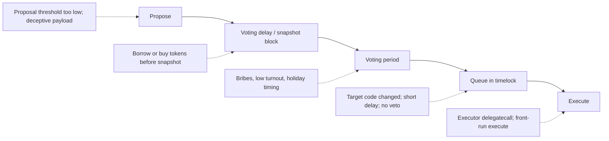

# Governance as Attack Surface

On-chain governance lets token holders change protocol parameters, upgrade contracts and spend treasuries. Whoever controls governance controls the protocol. It is often the most powerful "admin key", and it is held by a market.

That last sentence is the core idea of this book. A multisig admin key is held by named people; you can reason about their security. A governance token is held by whoever buys, borrows or is bribed into holding it at the right block. The security question becomes economic: how much does it cost to control the key, and how much can the key move?

## Historic incidents (public reports)

| Year | Protocol | What happened |
|---|---|---|
| 2022 | Beanstalk (~US$180M) | attacker flash-borrowed enough governance power to pass and immediately execute a malicious proposal via an emergency path |
| 2022 | Build Finance DAO | attacker accumulated enough tokens to pass a proposal granting themselves minting control |
| 2023 | Tornado Cash governance | a proposal's contract was replaced (via CREATE2 + self-destruct) with malicious code after voters approved its apparent content |
| 2024 | Compound | a contentious proposal by a large holder group directing treasury funds passed amid disputes over intent; resolved by negotiation |

Note the spread: one flash-loan attack, one slow accumulation, one deception, one dispute about legitimacy. Governance failures range from clear theft to "the rules worked as written and the outcome was still harmful". A review must cover both.

## Attack families

1. **Vote acquisition:** flash loans, borrowing, buying, bribing, delegation markets.
2. **Malicious proposals:** payloads that do something other than described.
3. **Process attacks:** low turnout, timing proposals during holidays, quorum manipulation.
4. **Execution attacks:** front-running execution, exploiting timelock or executor contracts.
5. **Off-chain governance:** Snapshot votes executed by multisigs; social engineering of signers.

## Where attacks land in the lifecycle



Each stage has a defender action too: review at proposal, monitor borrows before the snapshot, rally votes during voting, veto or exit during the timelock. If any stage has zero length, the corresponding defence disappears. Beanstalk's emergency path effectively collapsed the whole pipeline into one transaction.

## Worked example

*Execution status: not executed in this book's CI; verify locally.*

We read a Governor's parameters from a fork and compute two numbers every governance review should start with: **time to defend** and **cost to reach quorum**.

**Step 1: read the parameters.** Most OpenZeppelin Governor and Compound-style contracts expose the same views. Set `$GOV` and `$TL` to the governor and timelock you are reviewing (a public DAO is fine for reading; we only call view functions).

```bash
cast call $GOV "votingDelay()(uint256)"       --rpc-url $ETH_RPC
cast call $GOV "votingPeriod()(uint256)"      --rpc-url $ETH_RPC
cast call $GOV "proposalThreshold()(uint256)" --rpc-url $ETH_RPC
cast call $GOV "quorum(uint256)(uint256)" $(cast block-number --rpc-url $ETH_RPC) --rpc-url $ETH_RPC
cast call $TL  "getMinDelay()(uint256)"       --rpc-url $ETH_RPC
cast call $GOV "CLOCK_MODE()(string)"         --rpc-url $ETH_RPC   # OZ v5: blocknumber or timestamp
```

Delay and period are in blocks or seconds depending on `CLOCK_MODE` (ERC-6372). For a block-based governor on mainnet, multiply by 12 seconds.

**Step 2: time to defend.** Suppose you read: delay 7 200 blocks, period 50 400 blocks, timelock 172 800 seconds.

| Stage | Duration |
|---|---|
| Voting delay | 7 200 × 12 s = 1 day |
| Voting period | 50 400 × 12 s = 7 days |
| Timelock | 2 days |
| **Total from proposal to execution** | **10 days** |

Ten days is the window for reviewers to spot a malicious payload, for delegates to vote it down, and for users to exit. If the timelock were zero and the period one day, defenders would have two days in total.

**Step 3: cost to reach quorum.** Suppose quorum is 400 000 tokens and recent proposals drew 600 000 "for" votes from honest voters who would oppose an attack. An attacker needs more than 600 000 votes to win outright, and at least 400 000 to meet quorum if nobody opposes. If the token trades at US$5 with deep liquidity and can be borrowed at 10% APR:

- Buying 600 001 tokens: roughly US$3M plus slippage (and the attacker keeps the tokens).
- Borrowing them over the 1-day delay plus some margin: about `3 000 000 × 0.10 × 3 / 365 ≈ US$2 500` in interest, if that much is available to borrow.

Compare with what a passed proposal can move. If the timelock controls a US$50M treasury, the borrow route is many orders of magnitude cheaper than the prize. The only remaining defences are opposing votes, monitoring and veto. Record these numbers in the review; they make the risk legible to non-technical stakeholders.

**Step 4: confirm on a fork.** On `anvil --fork-url $ETH_RPC`, use `deal` in a Foundry test to give an attacker address the computed vote amount, self-delegate, roll past the delay, propose and vote. If the proposal reaches `Succeeded` state, your arithmetic matches the contract. This is read-only analysis against a local fork; do not submit anything to the real DAO.

## Common pitfalls

- Reviewing the Governor contract's code but not its live parameters, which is where most risk sits.
- Forgetting emergency or fast-track paths that bypass the normal delay.
- Measuring quorum against total supply when most supply is not delegated and cannot vote.
- Ignoring who holds the timelock's admin and proposer roles outside the Governor.
- Treating "nobody has attacked it yet" as evidence that attack cost exceeds treasury value.

## Exercises

1. Read the Beanstalk post-mortem and identify the single design choice that enabled the attack.
2. Find a DAO's governance parameters (quorum, voting delay, period, timelock) and assess them.
3. Explain how the Tornado Cash proposal deceived reviewers.
4. For the DAO in exercise 2, compute time to defend and borrow-based cost to reach quorum, and compare with its treasury.

## Further reading

- Beanstalk post-mortem (2022)
- OpenZeppelin Governor docs: <https://docs.openzeppelin.com/contracts/5.x/governance>
- Tornado Cash governance attack analyses (May 2023)
- Rekt leaderboard: <https://rekt.news/leaderboard/>
- ERC-6372 (contract clock): <https://eips.ethereum.org/EIPS/eip-6372>
