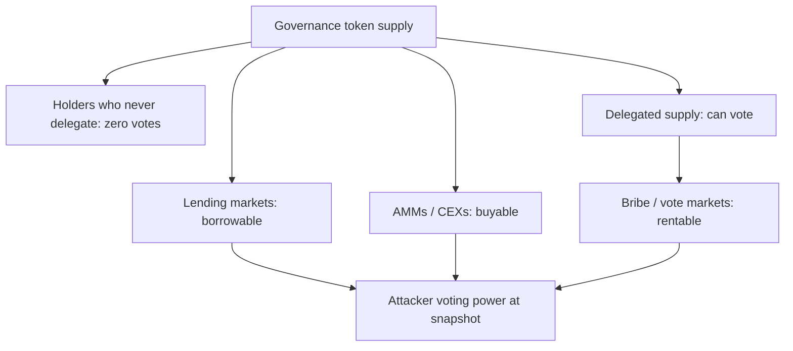

# Vote Acquisition Attacks

The first job of a governance attacker is to get votes. This chapter covers the main routes, from one-transaction flash loans to slow, legitimate-looking vote markets, and how to cost each one.

## Flash-loan voting

If voting power is measured at the time of the vote, an attacker can borrow tokens, vote, and repay in one transaction. Defence: **snapshot voting power at a past block** (e.g. proposal creation minus a delay). OpenZeppelin's `ERC20Votes` with `getPastVotes` implements checkpoints for this.

Checkpoints only help if every voting path uses them. Wrapped or staked versions of the token, LP positions counted as votes, or custom "voting escrow" contracts can each reintroduce current-balance reads.

## Borrowed voting power

Even with snapshots, an attacker can borrow tokens from a lending market *before* the snapshot and hold them through it. The cost is interest, often small relative to treasury size. Mitigations: longer voting delays (more interest), high quorum, monitoring of large borrows of governance tokens.

Two details make borrowing easier than it looks. First, the attacker only needs to hold tokens at the snapshot block, not for the whole voting period, because past votes are already recorded. They can repay the loan the block after the snapshot. Second, lending markets that list a governance token create, by design, a pool of rentable votes.

## Delegation and vote markets

Delegation concentrates power in delegates; vote markets (bribe platforms) let parties pay for votes. These are legitimate mechanisms in some ecosystems (e.g. Curve gauge voting markets) but can be used to pass harmful proposals cheaply.



The undelegated supply matters. Quorum is often set as a share of total supply, but only delegated tokens can vote. If 60% of supply sits undelegated on exchanges, real turnout is drawn from the other 40%.

## Cost of attack analysis

```
attack_cost = cost to acquire quorum-winning votes for the snapshot
            = min(buy cost incl. slippage, borrow cost over voting delay, bribe cost)
attack_profit = value controllable by a successful proposal (treasury, minting, upgrades)
secure if attack_cost >> attack_profit, or if a veto/timelock allows defence
```

Many DAOs have treasuries larger than the cost of acquiring a winning vote at typical turnout.

## Worked example

*Execution status: not executed in this book's CI; verify locally.*

Two parts: a Foundry test showing snapshots stop flash-loan voting, and a borrow-cost calculation with realistic constraints.

**Part A: snapshots in action.** Using OpenZeppelin v5 `ERC20Votes`:

```solidity
contract GovToken is ERC20, ERC20Permit, ERC20Votes {
    constructor() ERC20("Gov", "GOV") ERC20Permit("Gov") { _mint(msg.sender, 1_000_000e18); }
    function _update(address f, address t, uint256 v) internal override(ERC20, ERC20Votes) { super._update(f, t, v); }
    function nonces(address o) public view override(ERC20Permit, Nonces) returns (uint256) { return super.nonces(o); }
}

function test_flashVoteHasNoPower() public {
    // proposal created at block N; snapshot = N + votingDelay
    uint256 pid = governor.propose(targets, values, calldatas, "test");
    vm.roll(block.number + governor.votingDelay() + 1);

    // attacker "flash-borrows" after the snapshot
    token.transfer(attacker, 500_000e18);
    vm.prank(attacker); token.delegate(attacker);

    vm.prank(attacker);
    governor.castVote(pid, 1);
    (, uint256 forVotes,) = governor.proposalVotes(pid);
    assertEq(forVotes, 0);   // weight read at the snapshot block
}
```

Run `forge test -vv`. The vote is recorded with weight zero. Now move the transfer and `delegate` *before* the `vm.roll` and rerun: `forVotes` becomes 500 000e18. That second run is the "borrow before snapshot" attack, and no code change in the Governor prevents it.

**Part B: costing the borrow route.** Suppose a governance token has:

| Input | Value |
|---|---|
| Votes needed to beat expected opposition | 3 000 000 |
| Token available to borrow on a lending market | 4 000 000 |
| Borrow APR at current utilisation | 8% |
| Utilisation-driven APR after borrowing 3M | ~40% (rate curve kink) |
| Token price | US$4 |
| Collateral factor for the attacker's ETH | 80% |

The attacker needs collateral worth `3 000 000 × 4 / 0.8 = US$15M` of ETH, which they keep. Interest for holding over the snapshot, say two days at 40% APR: `12 000 000 × 0.40 × 2 / 365 ≈ US$26 300`. Add slippage if they must buy some tokens, and gas. The capital requirement (US$15M of collateral) is the real barrier, not the interest, and capital is easy to source for a large treasury prize.

Feed these numbers into the inequality above. If the governed treasury is US$100M and no veto exists, the protocol is economically insecure regardless of code quality. The fix is process (delay, veto, quorum on delegated supply) and monitoring, not Solidity.

## Common pitfalls

- Counting voting power from `balanceOf` anywhere, including in wrappers, staking contracts or Snapshot strategies.
- Setting quorum as a share of total supply when most supply is undelegated.
- Listing the governance token on a lending market with high borrow caps and no monitoring.
- Assuming the attacker must hold tokens for the whole voting period.
- Forgetting that `ERC20Votes` requires holders to delegate (even to themselves) before their balance counts.

## Exercises

1. Compute the cost to borrow enough governance tokens to pass a proposal in a real DAO at its historic turnout.
2. Implement snapshot-based voting and show a flash-loan vote fails.
3. Monitor governance token borrows on a lending market for a week.
4. Extend Part A with a staking wrapper that counts current balances as votes, and show it reopens the flash-loan path.

## Further reading

- OpenZeppelin ERC20Votes: <https://docs.openzeppelin.com/contracts/5.x/api/token/erc20#ERC20Votes>
- Fritsch et al., "Analyzing Voting Power in Decentralized Governance: Who Controls DAOs?", 2022
- ERC-5805 (voting with delegation): <https://eips.ethereum.org/EIPS/eip-5805>
