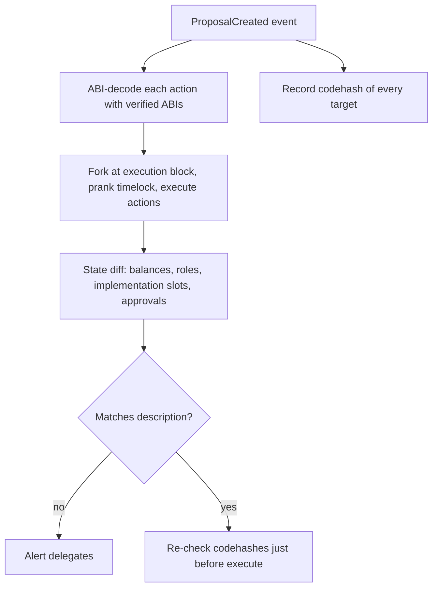

# Malicious Proposals

A proposal is executable code. Voters typically read a description; they rarely verify the payload.

In a Governor-style system a proposal is four arrays: `targets`, `values`, `calldatas` and a `description`. Only the first three execute. The description is a free-text string that the attacker writes. Every deception technique below exploits the gap between what people read and what the timelock will run.

## Deception techniques

| Technique | Description |
|---|---|
| Description/payload mismatch | text says "update parameter", calldata does something else |
| Metamorphic target | proposal calls a contract that is replaced before execution (CREATE2 + self-destruct; restricted after EIP-6780 except within creation tx) |
| Upgradeable target | proposal calls a proxy whose implementation is changed between vote and execution |
| Delegatecall payloads | proposal executes a delegatecall into attacker code in the timelock/treasury context |
| Hidden approvals | grants token approvals or roles buried among legitimate actions |
| Obfuscated calldata | many actions; one malicious |

The Tornado Cash case (May 2023) combined two rows. The proposal pointed at a contract whose verified source looked like a harmless copy of an earlier proposal, but it contained a self-destruct path. After the vote, the attacker destroyed it and redeployed different code at the same address, and the new code granted attacker-controlled accounts large voting power. EIP-6780 (Dencun, 2024) limits `SELFDESTRUCT` to the creation transaction, which closes that specific route on Ethereum mainnet, but upgradeable targets and delegatecall payloads remain.

## Defences

- **Simulate every proposal** on a fork at the expected execution block and diff state changes (balances, roles, implementation slots). Tools like Tenderly simulations, Foundry scripts, or dedicated proposal-simulation tooling make this routine.
- **Verify target code is immutable** or pinned (codehash checks at execution).
- **Bounded executor:** timelock that cannot delegatecall arbitrary targets.
- **Independent reviewers** (security councils, delegates with technical review) publishing analyses before voting ends.



## AI assistance

Models can decode calldata and explain each action, but the decoding must be done by tools (ABI decoding) and the explanation verified against the fork simulation's state diff. A model's summary of a proposal is exactly what an attacker would try to manipulate (via misleading names and comments).

## Worked example

*Execution status: not executed in this book's CI; verify locally.*

We build a toy DAO on Anvil, submit a proposal whose description says "raise the fee to 0.3%" but which also approves the treasury's tokens to an attacker, and catch it with a Foundry simulation and state diff. All contracts are local toys.

**Step 1: the payload.**

```solidity
address[] memory targets = new address[](2);
bytes[] memory data = new bytes[](2);
targets[0] = address(pool);
data[0]    = abi.encodeCall(Pool.setFee, (30));                       // as described
targets[1] = address(usdc);
data[1]    = abi.encodeCall(IERC20.approve, (attacker, type(uint256).max)); // not described
governor.propose(targets, new uint256[](2), data, "Raise swap fee to 0.3%");
```

**Step 2: decode with tools, not trust.** For each `calldatas[i]`, decode with the verified ABI:

```bash
cast 4byte-decode 0x095ea7b3000000000000000000000000<attacker>ffff...ffff
# 1) "approve(address,uint256)"
# <attacker address>
# 115792089237316195423570985008687907853269984665640564039457584007913129639935
```

A max approval from the timelock to an address that appears nowhere in the description is already a red flag.

**Step 3: simulate and diff.** Execute the actions as the timelock on a fork, recording state changes:

```solidity
function test_simulateProposal() public {
    vm.startStateDiffRecording();
    vm.startPrank(address(timelock));
    for (uint256 i; i < targets.length; i++) {
        (bool ok,) = targets[i].call{value: values[i]}(calldatas[i]);
        require(ok, "action failed");
    }
    vm.stopPrank();
    Vm.AccountAccess[] memory diff = vm.stopAndReturnStateDiff();
    for (uint256 i; i < diff.length; i++) {
        for (uint256 j; j < diff[i].storageAccesses.length; j++) {
            Vm.StorageAccess memory s = diff[i].storageAccesses[j];
            if (s.isWrite && s.previousValue != s.newValue)
                console.log(diff[i].account, uint256(s.slot));
        }
    }
    assertEq(usdc.allowance(address(timelock), attacker), 0, "undisclosed approval");
}
```

Expected: two written slots, one in the pool (fee) and one in USDC (the allowance mapping), and the final assertion fails with `undisclosed approval`. The state diff is the ground truth. The description and any model summary are claims to be checked against it.

**Step 4: pin code.** Record `targets[i].code.length` and `extcodehash` at proposal time and compare again before execution. A simple executor guard:

```solidity
require(target.codehash == expectedCodehash[proposalId][i], "target code changed");
```

For proxies, also record the implementation slot (ERC-1967: `0x360894a13ba1a3210667c828492db98dca3e2076cc3735a920a3ca505d382bbc`) and compare it.

## Common pitfalls

- Reading the description and the forum post instead of the calldata.
- Simulating at the current block instead of the expected execution block, missing state that changes in between (for example a proxy upgrade queued separately).
- Decoding calldata with an ABI supplied by the proposer rather than the verified on-chain ABI.
- Ignoring `values` (ETH sent with actions) and `delegatecall`-style executor functions.
- Checking only the first-level target, not contracts the target calls into.
- Accepting a model's plain-language summary without the state diff beside it.

## Exercises

1. Write a Foundry script that simulates a Governor proposal and outputs a state diff.
2. Construct a proposal with a description/payload mismatch and check whether your simulation catches it.
3. Add a codehash check to an executor.
4. Build a proposal whose target is an upgradeable proxy, upgrade the proxy between vote and execution in your test, and show the implementation-slot check catches it.

## Further reading

- Tenderly simulation: <https://docs.tenderly.co>
- Foundry fork testing: <https://book.getfoundry.sh/forge/fork-testing>
- EIP-6780: <https://eips.ethereum.org/EIPS/eip-6780>
- ERC-1967 (proxy storage slots): <https://eips.ethereum.org/EIPS/eip-1967>
- Foundry state diff cheatcodes (`startStateDiffRecording`): <https://book.getfoundry.sh/cheatcodes/>
