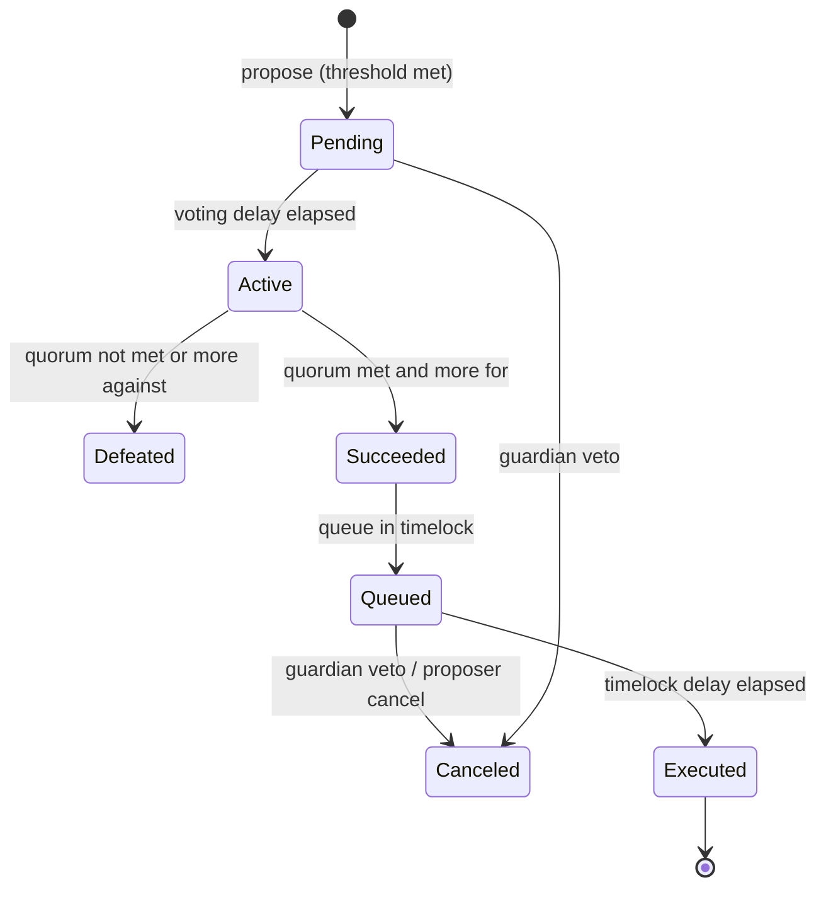

# Governance Process and Parameter Design

Code bugs in a Governor are rare; most governance risk is in its parameters and in the paths around it. This chapter treats parameters as security controls and shows how to choose them from numbers rather than habit.

## Key parameters

| Parameter | Too low | Too high |
|---|---|---|
| Proposal threshold | spam, malicious proposals | only whales can propose |
| Voting delay | no time to react or snapshot-gaming | slow governance |
| Voting period | low participation; rushed attacks | slow governance |
| Quorum | small coalitions pass proposals | nothing passes |
| Timelock delay | no time for users to exit or guardians to veto | slow emergency response |

Each parameter maps to a defender action. Voting delay is the time to notice a proposal and to watch for borrowed votes before the snapshot. Voting period is the time to mobilise opposition. Timelock delay is the time to veto or exit. Proposal threshold limits who can start the clock.

## Emergency paths

Beanstalk's emergency commit allowed immediate execution with a supermajority, which combined with flash-loaned votes. Emergency paths should require a separate, small, accountable body (security council) and be limited in scope (pause, not arbitrary execution).

A good emergency path is asymmetric: it can make the protocol *safer* quickly (pause, lower caps, cancel a queued proposal), but cannot move funds or change ownership quickly. Anything that can move funds goes through the full delay.

## Vetoes and guardians

A guardian or council veto can stop malicious proposals that pass. It adds trust but often provides a valuable last line of defence. Document veto powers and sunset plans.



The states mirror OpenZeppelin's `ProposalState` enum. A review should establish, for every transition, who can trigger it and how long it takes.

## Optimistic governance

Some protocols use optimistic models: a trusted team proposes, token holders can veto within a window. This flips the burden: attacks require compromising the proposer, and defence requires an active veto.

## Worked example

*Execution status: not executed in this book's CI; verify locally.*

We choose a timelock delay from user-exit requirements, and set quorum from turnout data, for a hypothetical lending protocol. Then we encode the result in an OpenZeppelin Governor and test it.

**Step 1: timelock from exit time.** The timelock must be long enough for a careful user to notice a malicious queued proposal and withdraw. Estimate each step:

| Step | Estimate |
|---|---|
| Monitoring bots and reviewers flag the proposal | 6 hours |
| Public alert reaches most users (forum, social, wallet notices) | 18 hours |
| User repays debt and withdraws collateral | 2 hours |
| Withdrawal queue or cooldown in the protocol itself | 24 hours |
| Margin for weekends, time zones | 24 hours |
| **Total** | **74 hours ≈ 3 days** |

A 2-day timelock is too short for this protocol because of its own 24-hour withdrawal cooldown. Either lengthen the timelock to at least 3 days or remove the cooldown for withdrawals during a pending governance action.

**Step 2: quorum from turnout.** Look at the last 20 proposals. Suppose "for + against + abstain" ranged from 8M to 25M votes, median 14M, out of 100M supply of which 45M is delegated. A quorum of 4% of supply (4M) is reachable by a borrower with a few million tokens when turnout is low. A quorum of 10M is met by most honest proposals while forcing an attacker to acquire more than the typical opposition. Set quorum around the lower tail of honest turnout, and pair it with vote differential (for must exceed against), which Governor already enforces.

**Step 3: encode and test.** OpenZeppelin v5 modules:

```solidity
contract LendGov is Governor, GovernorSettings, GovernorCountingSimple,
    GovernorVotes, GovernorVotesQuorumFraction, GovernorTimelockControl
{
    constructor(IVotes t, TimelockController tl)
        Governor("LendGov")
        GovernorSettings(7200 /* 1 day */, 50400 /* 7 days */, 100_000e18)
        GovernorVotes(t)
        GovernorVotesQuorumFraction(10)      // 10% of past total supply
        GovernorTimelockControl(tl) {}
    // required overrides omitted for brevity
}
// TimelockController deployed with minDelay = 3 days
```

Write a test that walks a proposal through `Pending → Active → Succeeded → Queued`, then asserts `execute` reverts until `block.timestamp >= eta`. Add a test where a guardian holding `CANCELLER_ROLE` on the timelock cancels a queued operation. Check also that nobody else holds `PROPOSER_ROLE` or `EXECUTOR_ROLE` on the timelock unexpectedly, and that the timelock's own admin role was renounced.

Note: `GovernorVotesQuorumFraction` uses total supply, not delegated supply. If delegation is low, a fraction of total supply can be both too high for honest proposals and still too low against a concentrated attacker. Check with the turnout data before trusting it.

## Common pitfalls

- Timelock delays shorter than the protocol's own withdrawal cooldowns, so users cannot exit in time.
- Emergency paths that can execute arbitrary calls rather than only pausing.
- Leaving deployer addresses with timelock admin, proposer or canceller roles.
- Quorum fixed at launch and never revisited as supply and delegation change.
- Veto powers that are undocumented, so the community discovers them only when they are used.
- Upgrading Governor parameters through governance itself with no extra delay.

## Exercises

1. Evaluate three DAOs' parameters against the table and recommend changes.
2. Design an emergency path with scoped powers for a lending protocol.
3. Compare Governor-style and optimistic governance for a treasury of US$50M.
4. Recompute the worked-example timelock for a protocol with instant withdrawals but a 7-day unstaking period for its governance token.

## Further reading

- OpenZeppelin Governor docs: <https://docs.openzeppelin.com/contracts/5.x/governance>
- Compound Governor Bravo: <https://docs.compound.finance/v2/governance/>
- Lido dual governance design discussions: <https://research.lido.fi>
- OpenZeppelin `TimelockController`: <https://docs.openzeppelin.com/contracts/5.x/api/governance#TimelockController>
