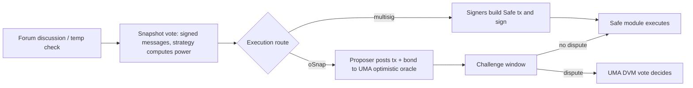

# Off-Chain and Hybrid Governance

Many DAOs vote on Snapshot (off-chain, signed messages) and execute through multisigs. Others use oSnap-style optimistic execution of Snapshot results.

Off-chain voting is cheap and flexible, but it moves the binding step somewhere else. A Snapshot vote by itself changes nothing on-chain. Something must turn the result into a transaction: a multisig whose signers promise to follow the vote, or an optimistic module that executes unless disputed. That translation step is where this chapter focuses.



## Risks

- **Multisig signers** must faithfully execute results; their keys become critical (see **web3-supply-chain-security**).
- **Snapshot strategy configuration:** voting power strategies are configurable; a misconfigured strategy can count tokens incorrectly or allow double counting.
- **Optimistic execution:** if nobody disputes within the window, the transaction executes. A malicious transaction posted during low attention can pass.
- **Forum and social layer:** discussions, temperature checks and delegate communications can be manipulated (sock puppets, misleading summaries).
- **Signing interface compromise:** signers approve what their wallet or web UI shows them. The Bybit incident (February 2025, roughly US$1.5B according to public reports) involved a compromised Safe web interface that showed signers a routine transfer while the payload changed the wallet's implementation. Independent hash verification on a separate device is the defence.

## Controls

- Monitor every proposal and optimistic execution request; alert on high-value actions.
- Require multisig signers to independently verify payloads (hash verification).
- Publish Snapshot strategy configuration and review changes.
- Maintain dispute bond funds and responders for optimistic systems.

## Social-layer attacks

Off-chain governance relies on forums, chats and delegate communication. Attackers can create sock-puppet accounts to simulate consensus, publish misleading summaries of proposals, or time controversial votes for periods of low attention. Defences are mostly process: require on-chain or signed delegate statements, publish independent technical reviews for every executable proposal, and keep a public calendar of votes so the community is not surprised.

## Worked example

*Execution status: not executed in this book's CI; verify locally.*

A signer is asked to execute a Snapshot result: "Transfer 250 000 USDC from the treasury Safe to the grants multisig." We verify, independently of any web UI, that the transaction hash on the hardware wallet corresponds to exactly that action. Use a fork or a test Safe; the commands below only read state.

**Step 1: build the expected calldata yourself.**

```bash
USDC=0xA0b86991c6218b36c1d19D4a2e9Eb0cE3606eB48
GRANTS=0x...   # from the Snapshot proposal, checked against the forum
DATA=$(cast calldata "transfer(address,uint256)" $GRANTS 250000000000)  # 6 decimals
echo $DATA
```

**Step 2: read the Safe's nonce and compute the Safe transaction hash on-chain.** Safe exposes `getTransactionHash` as a view function:

```bash
NONCE=$(cast call $SAFE "nonce()(uint256)" --rpc-url $ETH_RPC)
cast call $SAFE \
 "getTransactionHash(address,uint256,bytes,uint8,uint256,uint256,uint256,address,address,uint256)(bytes32)" \
 $USDC 0 $DATA 0 0 0 0 0x0000000000000000000000000000000000000000 \
 0x0000000000000000000000000000000000000000 $NONCE --rpc-url $ETH_RPC
```

The fourth argument `0` is `operation = CALL`. A `1` would be `DELEGATECALL`, which in a Safe lets the target run code in the Safe's own storage context. A transfer never needs it.

**Step 3: compare.** The hash printed must equal the `safeTxHash` shown on the hardware wallet (or in the signing request). If it differs, stop: the UI is asking you to sign something else. Tools such as `safe-tx-hashes-util` by pcaversaccio automate this check from the Safe transaction service data, but the point is that you can always recompute it from first principles with `cast`.

**Step 4: decode what you are actually given.** If the UI provides raw data, decode it:

```bash
cast calldata-decode "transfer(address,uint256)" $DATA_FROM_UI
```

and check the `to`, `value` and `operation` fields as well as the data. A different `to` with identical-looking calldata is still a different transaction.

**Step 5: oSnap variant.** For optimistic execution, the same checks apply to the transactions posted with the assertion. A watcher script should fetch each new assertion, decode its transactions, compare them with the Snapshot proposal's declared payload, and alert if they differ, leaving enough of the challenge window to post a dispute bond.

## Common pitfalls

- Signers trusting the web UI's human-readable summary and never checking the hash on the signing device.
- Accepting `DELEGATECALL` operations from a treasury Safe without a specific, reviewed reason.
- Snapshot strategies that count the same tokens twice (wallet balance plus staked or LP balance).
- Optimistic challenge windows with nobody funded and on call to dispute.
- Off-chain votes whose execution payload is only described in prose, so signers improvise the calldata.

## Exercises

1. Review a DAO's Snapshot space settings and strategies.
2. Set up alerts for new optimistic execution requests for one DAO.
3. Write the signer procedure for executing a Snapshot result.
4. Using a test Safe on a fork, create a transaction with `operation = 1` and show how its hash differs from the `CALL` version with otherwise identical fields.

## Further reading

- Snapshot docs: <https://docs.snapshot.box>
- UMA oSnap: <https://docs.uma.xyz>
- Safe docs: <https://docs.safe.global>
- safe-tx-hashes-util: <https://github.com/pcaversaccio/safe-tx-hashes-util>
- Safe smart account contracts: <https://github.com/safe-global/safe-smart-account>
