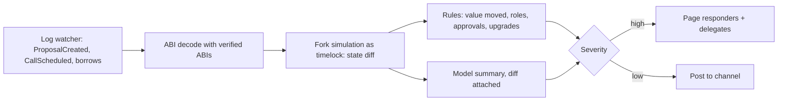

# Governance Monitoring and Response

Parameters and reviews reduce governance risk; monitoring is what lets defenders use the time those parameters buy. This chapter describes what to watch, how to respond, and a minimal pipeline you can build in an afternoon.

## What to monitor

| Signal | Why |
|---|---|
| New proposals and their payloads (simulated) | detect malicious actions early |
| Large token borrows or transfers before snapshots | detect vote acquisition |
| Sudden delegation changes | detect coalition building |
| Timelock queue | last chance before execution |
| Executor and timelock admin changes | governance takeover attempts |

Useful on-chain events for an OpenZeppelin-style system:

| Contract | Event | Meaning |
|---|---|---|
| Governor | `ProposalCreated` | new proposal with full actions |
| Governor | `VoteCast` | vote with weight; watch for large single voters |
| Token | `DelegateChanged`, `DelegateVotesChanged` | delegation shifts |
| Timelock | `CallScheduled`, `CallExecuted`, `Cancelled` | queued and executed operations |
| Timelock | `RoleGranted`, `RoleRevoked` | control changes |

## Response options

- Public alerts to delegates and token holders.
- Rallying votes against (requires an engaged community).
- Guardian veto or cancellation (if available).
- Users exiting during timelock (if contracts allow).
- Coordinated disclosure with SEAL 911 if an exploit is involved.

Decide in advance who may trigger each response and on what evidence. A tabletop run before an incident is far cheaper than improvising during one.

## Automation

A governance monitor can: fetch new proposals, simulate them on a fork, produce a state diff, ask a model for a plain-language summary (with the diff as ground truth), and post to a channel. The diff, not the summary, is the authority.



Rules decide severity; the model only writes prose. If the model's summary and the rule output disagree, the rules win and the disagreement itself is logged for review.

## Worked example

*Execution status: not executed in this book's CI; verify locally.*

We build a minimal monitor for one Governor using `cast` and a Foundry simulation script, then add a borrow watcher. Point it at a local fork first; reading public chain data is fine, but do not interfere with a live DAO's process.

**Step 1: watch for proposals.** OpenZeppelin Governor's event:

```bash
SIG="ProposalCreated(uint256,address,address[],uint256[],string[],bytes[],uint256,uint256,string)"
cast logs --rpc-url $ETH_RPC --address $GOV --from-block $LAST --to-block latest "$SIG" --json \
  > new_proposals.json
```

The event data contains `targets`, `values` and `calldatas`. Decode it with `cast abi-decode` or a small script, store each proposal ID, and skip IDs already processed.

**Step 2: simulate.** For each new proposal, run the simulation test from Chapter 3 with the decoded arrays passed via environment variables or a JSON file read with `vm.readFile` and `vm.parseJson`:

```bash
PROPOSAL_JSON=out/p_$ID.json forge test --mt test_simulateProposal \
  --fork-url $ETH_RPC --json > out/sim_$ID.json
```

**Step 3: apply rules.** A few simple rules catch most dangerous payloads:

| Rule | Trigger |
|---|---|
| Value out | timelock's token or ETH balance falls by more than 1% of treasury |
| New allowance | any `Approval` from the timelock to an address not in the description |
| Role change | any `RoleGranted`, `OwnershipTransferred` or `AdminChanged` |
| Upgrade | write to an ERC-1967 implementation or admin slot |
| Delegatecall | any action that results in a `DELEGATECALL` from the timelock |

Any trigger is high severity until a human signs off.

**Step 4: borrow watcher.** For a governance token listed on Aave V3, watch `Borrow` events on the Pool filtered by `reserve = token`:

```bash
cast logs --rpc-url $ETH_RPC --address $AAVE_POOL --from-block $LAST \
  "Borrow(address,address,address,uint256,uint8,uint256,uint16)" $TOKEN
```

Alert when a single address borrows more than, say, 10% of the median honest "for" vote within the voting-delay window of any open proposal.

**Step 5: tabletop.** Feed the monitor the toy malicious proposal from Chapter 3. Expected output: `New allowance` triggers, severity high, summary attached. Time the whole path from event to alert; if it takes longer than a fraction of the voting delay, tighten polling or move to a streaming RPC subscription.

## Common pitfalls

- Monitoring only new proposals and not the timelock queue, where operations can arrive from roles other than the Governor.
- Letting a model's summary decide severity.
- Alert channels nobody watches on weekends.
- No pre-agreed authority to use a veto, so the decision stalls while the timelock runs out.
- Forgetting cross-chain execution: proposals that send messages to L2 executors need simulation on the destination chain too.

## Exercises

1. Build the monitor for one Governor contract.
2. Add a borrow-monitor for the governance token on major lending markets.
3. Run a tabletop: a malicious proposal is detected with 48 hours left in voting.
4. Add a rule for proposals whose actions target contracts with no verified source, and test it with a toy proposal.

## Further reading

- Tally (Governor dashboards): <https://www.tally.xyz>
- Forta governance monitoring examples: <https://docs.forta.network>
- SEAL 911: <https://securityalliance.org>
- OpenZeppelin Governor events reference: <https://docs.openzeppelin.com/contracts/5.x/api/governance>
